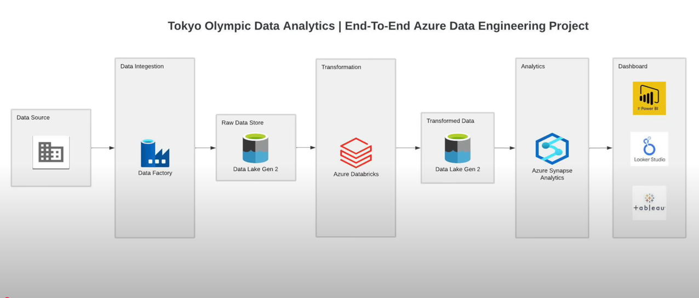

# 🏅 Tokyo Olympics Data Pipeline on Azure

An end-to-end data pipeline on Microsoft Azure: it **collects** five Tokyo 2020 Olympics datasets, **stores** them in a data lake, **transforms** them with PySpark, and makes them **queryable with SQL**.

## What it does, step by step

| Step | Azure service | What happens |
|---|---|---|
| **1. Ingest** | Azure Data Factory | The `raw_data_ingestion` pipeline runs 5 copy activities that download the CSV files from this repo (over HTTP) into the **raw-data** folder of the data lake |
| **2. Store** | Azure Data Lake Storage Gen2 | Raw and transformed data are kept in **separate folders**, so the original data is never overwritten |
| **3. Transform** | Azure Databricks (PySpark) | The notebook loads the 5 tables, fixes column types (e.g. gender entry counts to integers), runs two analyses, and writes the results to the **transformed-data** folder |
| **4. Query** | Azure Synapse Analytics | A lake database (`TokyoOlympicDB`) exposes the transformed files as SQL tables |

**The analyses in the notebook**
- Countries ranked by gold medals
- Share of female and male entries in each sport (discipline)

## The data

| File | Rows | Contains |
|---|---|---|
| `Athletes.csv` | 11,085 | Athlete name, country, sport |
| `Coaches.csv` | 394 | Coach name, country, sport, event |
| `Teams.csv` | 743 | Team name, sport, country, event |
| `EntriesGender.csv` | 46 | Female, male and total entries per sport |
| `Medals.csv` | 93 | Gold, silver, bronze and total medals per country |

## What's in this repo

| Folder | What it is |
|---|---|
| `data/` | The 5 source CSV files (the pipeline downloads them from here) |
| `pipeline/` | The Data Factory ingestion pipeline (`raw_data_ingestion.json`) |
| `dataset/`, `linkedService/`, `integrationRuntime/`, `factory/` | Data Factory datasets and connections, saved through its Git integration |
| `tokyo-olympic25-df/` | ARM templates to re-create the Data Factory in another Azure account |
| `databricks/` | The PySpark transformation notebook |
| `database/`, `sqlscript/` | The Synapse lake database tables and a SQL script |
| `project.png` | The architecture diagram |

## Skills shown

Azure Data Factory · Azure Data Lake Storage Gen2 · Azure Databricks · PySpark · Azure Synapse Analytics · ETL pipelines · ARM templates · Git-based deployment

## How to run it

You need an Azure subscription with Data Factory, a Data Lake Storage Gen2 account, Databricks and Synapse.

1. Create a storage account with a container, and `raw-data` / `transformed-data` folders.
2. Deploy the Data Factory from the ARM templates in `tokyo-olympic25-df/` (you'll be asked for your storage details), then run the `raw_data_ingestion` pipeline.
3. Import `databricks/Tokyo Olympic Transformation.ipynb` into Databricks. Store your app's client secret in a **Databricks secret scope** (never in the notebook), update the storage names, and run it.
4. In Synapse, create the lake database tables over the `transformed-data` folder and query them with SQL.

## What I'd improve next

- Proper cleaning: missing values, duplicates and text formatting
- Save as Parquet or Delta tables instead of single CSV files
- One parameterised copy activity (ForEach) instead of five, plus a schedule trigger
- Real SQL analysis in Synapse, and a Power BI dashboard on top
- Data quality checks after each step

## Author

**Yasitha Priyashan** · Master of Data Science & AI, University of Moratuwa · [GitHub](https://github.com/YasithaNV2001)
